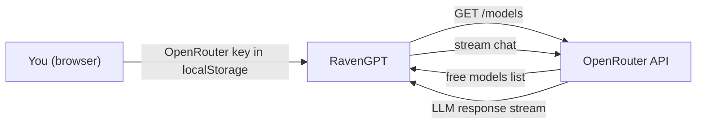

# RavenGPT

An AI chat interface that runs entirely in your browser. You bring an OpenRouter API key; the app never touches a server. Four modes — standard chat, visible-reasoning, web search with citations, and vision — each with dynamic model discovery so you're always working with whatever free models OpenRouter has live.

**Live demo:** [raven-gpt0.vercel.app](https://raven-gpt0.vercel.app)

   

---

## How It Works

Every request goes straight from your browser to OpenRouter. Nothing is logged, proxied, or stored on my end — your API key lives in your browser's local storage, and your conversations never leave your machine except as direct API calls.



## Feature Modes

| Mode | What it does | Typical models |
| --- | --- | --- |
| **Standard** | Fast text conversation with any free model | Llama, Mistral, Zephyr, OpenChat |
| **Reasoning** | Deep-thinking models with a visible chain of thought you can toggle on/off; configurable effort (low/medium/high) | DeepSeek R1, QwQ |
| **Web Search** | Pulls current information with automatic source citations | Any web-enabled model |
| **Vision** | Upload images or documents and chat about them | Multi-modal models |

The model picker is not hardcoded. RavenGPT queries OpenRouter's live catalog, filters to $0.00 models for the selected mode, and falls back to a curated shortlist (Llama 3.2 3B/1B, Zephyr 7B, OpenChat 7B, Mistral 7B) if the fetch fails.

## Running It Locally

```bash
git clone https://github.com/1m1ssher/RavenGPT.git
cd RavenGPT
npm install
npm run dev
```

Open `http://localhost:3000`, paste your OpenRouter key from [openrouter.ai/keys](https://openrouter.ai/keys), and go. New OpenRouter accounts get free credits, and a large set of models is permanently free.

## Technical Notes

- **Stack:** Next.js 15 (App Router), TypeScript, Tailwind CSS, React Markdown, Lucide icons
- **Streaming:** responses render token-by-token with full Markdown
- **Attachments:** drag-and-drop or click upload for images and documents, rendered inline in the conversation
- **Theme:** respects system dark/light preference
- **Customization:** swap or extend the fallback model list in `src/app/page.tsx`; the API call lives in a single `sendMessage` function if you want to point it elsewhere

## Troubleshooting

| Symptom | First thing to check |
| --- | --- |
| "Invalid API Key" | Re-copy the key from [openrouter.ai/keys](https://openrouter.ai/keys) |
| Model not responding | Switch models — free-model availability changes |
| Blank stream | Check browser console; most failures surface there |
| Network error | OpenRouter is up at [status.openrouter.ai](https://status.openrouter.ai) |

## Status

Active personal project. Features move fast and some are experimental, so expect churn — bug reports and suggestions are welcome as issues.

## License

MIT.
